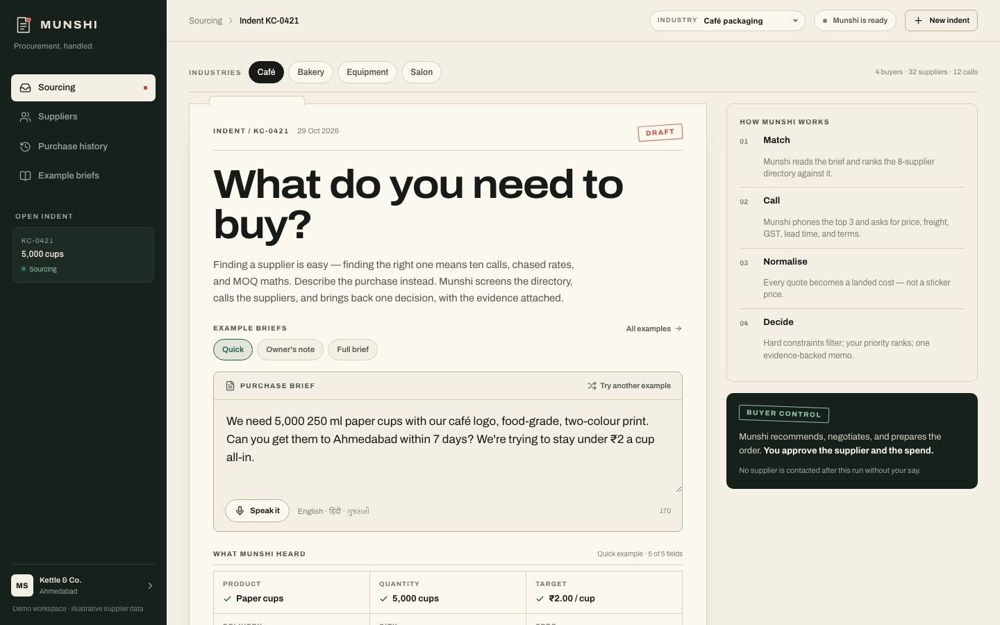
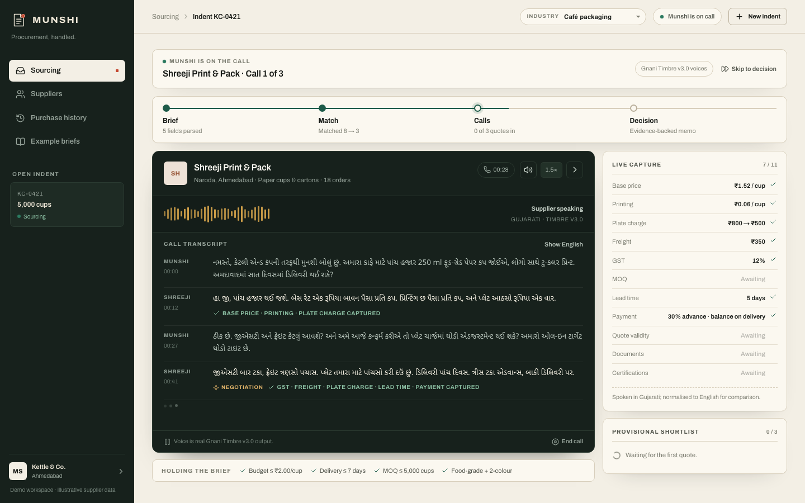
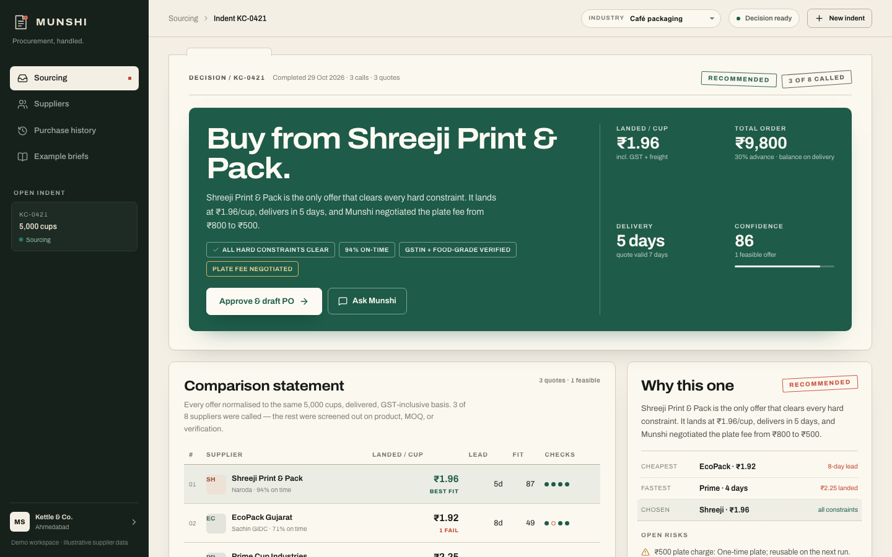
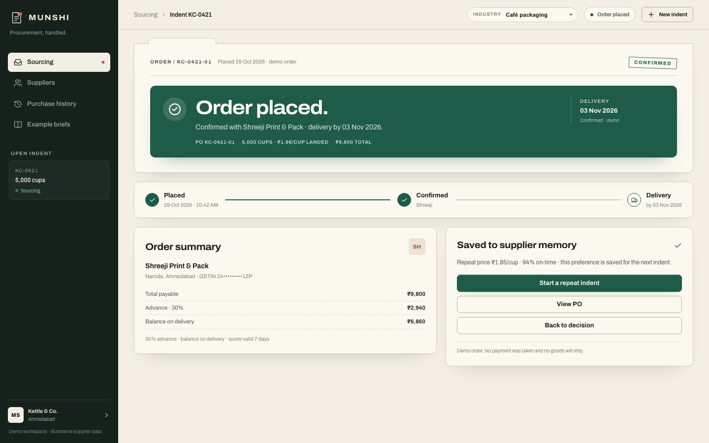
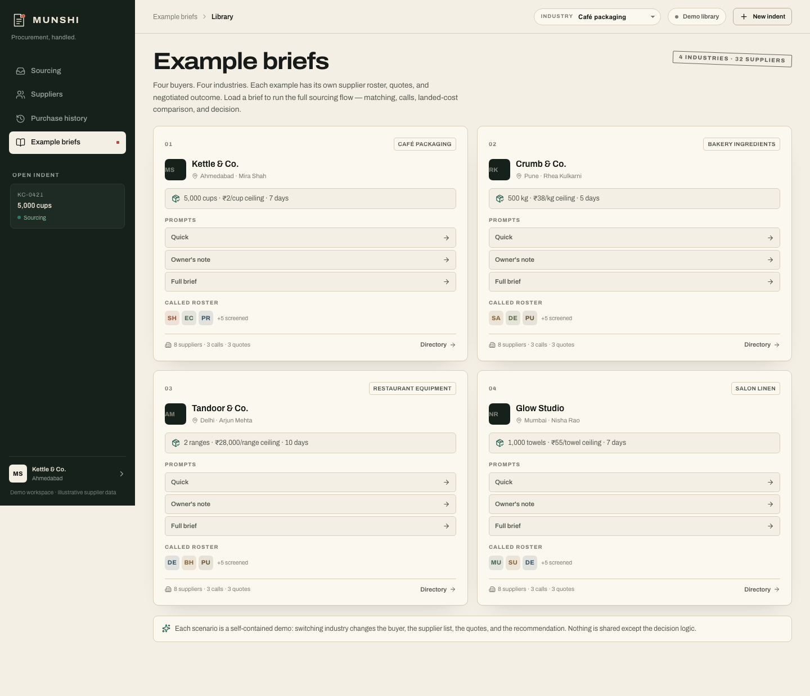
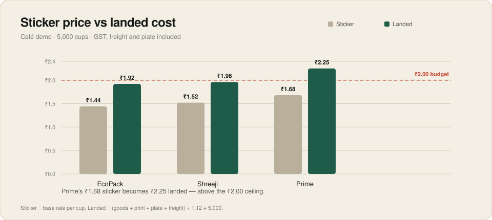
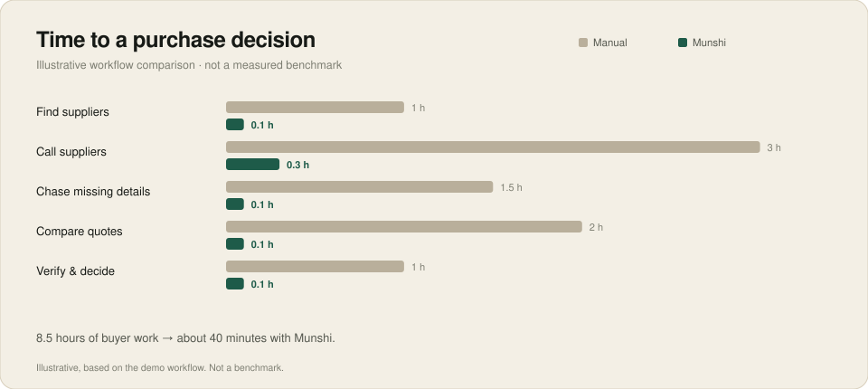
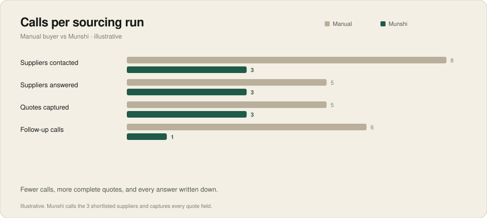
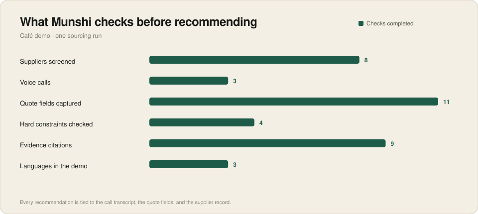
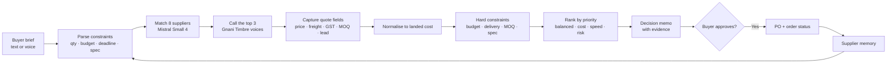

# Munshi — Procurement, handled.

**A buyer-side AI procurement agent for Indian small businesses.** Describe a purchase in plain language; Munshi screens suppliers, calls them in Indic languages, normalises every quote to a landed cost, verifies the details, and returns **one evidence-backed decision**. The buyer approves the supplier and the spend — Munshi never buys on its own.

`Next.js 16` · `React 19` · `TypeScript` · `Gnani Prisma v3.0` · `Gnani Timbre v3.0` · `Mistral Small 4` · deterministic decision engine



---

## The problem

Finding a supplier is easy. IndiaMART gives a café owner 50 phone numbers in minutes. **Choosing the right supplier is the hard part.**

She then spends days calling vendors, chasing rates that never came in writing, comparing MOQs, decoding plate charges and freight, guessing whose delivery promise is real, and checking GSTIN and food-grade certificates. The purchase lives in her head across a week of WhatsApps — and she still often overpays or gets burned on delivery.

Marketplaces are paid to generate supplier leads. **Nobody works for the buyer to turn messy conversations into a defensible decision.** That is the gap Munshi fills.

## The product

Munshi is the buyer's clerk for the part after discovery.

1. **Brief** — the buyer describes the purchase naturally: product, quantity, target price, delivery window, city, and spec. Voice input works in English, Hindi, or Gujarati.
2. **Match** — Munshi screens a curated 8-supplier directory, shortlists 3, and explains why each excluded supplier was screened out.
3. **Call** — it phones the shortlist in the buyer's language, asks the questions a good buyer would ask, negotiates, and captures every quote field.
4. **Decide** — every offer is normalised to a landed cost, checked against hard constraints, ranked by the buyer's priority, and returned as one memo with the supplier's own words attached.

The buyer keeps the pen: Munshi recommends, negotiates, and prepares the PO. **No spend moves until the buyer approves.**

## Four industries, four buyers, 32 unique suppliers

| Industry | Buyer | Example brief | Recommendation |
| --- | --- | --- | --- |
| **Café packaging** | Kettle & Co., Ahmedabad | 5,000 paper cups, ₹2/cup, 7 days | Shreeji Print & Pack · **₹1.96/cup** |
| **Bakery ingredients** | Crumb & Co., Pune | 500 kg maida, ₹38/kg, 5 days | Sahyadri Mills · **₹35.23/kg** |
| **Restaurant equipment** | Tandoor & Co., Delhi | 2 gas ranges, ₹28,000 each, 10 days | Delhi Kitchen Works · **₹27,258/range** |
| **Salon linen** | Glow Studio, Mumbai | 1,000 towels, ₹55 each, 7 days | Mumbai Linen Co. · **₹47.49/towel** |

Each industry has its own **8-supplier roster** (3 called, 5 screened), its own quotes, negotiation, delivery record, and buyer memory. Nothing is shared except the decision logic.

### The demo, in one line

> A café in Ahmedabad needs 5,000 branded paper cups. Munshi calls three suppliers in Gujarati, negotiates the plate fee from ₹800 to ₹500, and proves that the cheapest sticker price is not the right purchase.

---

## See it working

<table>
<tr>
<td width="50%"><br><sub><b>Live call.</b> Real Gnani Timbre voices in Gujarati. The negotiation is marked, and every captured field lands in the quote panel.</sub></td>
<td width="50%"><br><sub><b>Decision.</b> One verdict, the landed cost, the total, the delivery window, and the evidence behind it.</sub></td>
</tr>
<tr>
<td width="50%"><br><sub><b>After approval.</b> Order placed, confirmed, and scheduled for delivery — with the PO and supplier memory saved.</sub></td>
<td width="50%"><br><sub><b>Example library.</b> Four industries, three prompt variants each, and the called roster for every scenario.</sub></td>
</tr>
</table>

<sub>Also responsive at 390 px — [mobile view](docs/screenshots/mobile.png).</sub>

---

## How the decision is made

Munshi does not “ask an LLM to pick a supplier.” The recommendation is computed and inspectable.

### 1. Every quote is normalised to landed cost

Sticker price is not comparable. Munshi adds printing, one-time charges, freight, and GST, then divides by the order quantity:

```
landed = (qty × unit price + qty × printing + one-time + freight) × (1 + GST) ÷ qty
```



In the café demo, Prime's ₹1.68 sticker becomes **₹2.25 landed** — above the ₹2.00 ceiling. That is the difference between a rate on the phone and a purchase decision.

### 2. Hard constraints decide eligibility

Any offer that breaks the budget, deadline, MOQ, or required spec is **disqualified**, however cheap it looks. The score only orders the survivors.

| Constraint | Shreeji | EcoPack | Prime |
| --- | --- | --- | --- |
| Budget ≤ ₹2.00 | ✅ ₹1.96 | ✅ ₹1.92 | ❌ ₹2.25 |
| Delivery ≤ 7 days | ✅ 5 | ❌ 8 | ✅ 4 |
| MOQ ≤ 5,000 | ✅ | ✅ (negotiated from 10,000) | ✅ |
| Food-grade + 2-colour | ✅ | ✅ | ✅ |
| **Result** | **Feasible** | **Disqualified** | **Disqualified** |

Shreeji wins because it is the **only offer that clears every hard constraint** — not because it is the cheapest or the fastest.

### 3. Priority ranks the survivors

When several offers pass, the buyer's priority decides the order: **Balanced / Lowest cost / Fastest / Lowest risk**, weighting price, delivery, on-time reliability, and verification.

### 4. The buyer controls the trade-off

The decision board exposes the levers. Relax the deadline and EcoPack becomes feasible; raise the ceiling and Prime enters; switch priority and the recommendation recomputes live. **Munshi recommends; the buyer decides which constraint to trade.**

---

## Why AI-native

The workflow charts below are **illustrative comparisons of the demo workflow, not measured benchmarks**. The quote chart uses the actual demo data.







The point is not that AI makes phone calls faster. It is that the agent **closes the loop**: it asks the follow-up question, writes the answer down, normalises it, and carries the evidence into the decision. A buyer does that work across days and a notepad.

---

## AI stack

| Layer | Model / system | Role |
| --- | --- | --- |
| **Speech-to-text** | **Gnani Prisma v3.0** | Buyer briefs by voice in English, Hindi, or Gujarati; automatic Indic language detection. |
| **Text-to-speech** | **Gnani Timbre v3.0** | Every supplier call is voiced in Gujarati, Marathi, or Hindi — one language per industry. |
| **Supplier matching** | **Mistral Small 4** (`mistral-small-2603`) | Ranks the 8-supplier roster, shortlists 3, and writes a concrete reason for every screened supplier. Local-rules fallback if unavailable. |
| **Decision engine** | Deterministic TypeScript (`lib/engine.ts`) | Landed-cost maths, hard-constraint filtering, weighted ranking, recommendation, and grounded Q&A. Not an LLM judgement. |

**One language per industry:** Café → Gujarati · Bakery → Marathi · Equipment → Hindi · Salon → Hindi. The transcript shows the original script by default, with a **Show English** toggle.

### Architecture



---

## What is real vs. simulated

| Real | Simulated / demo |
| --- | --- |
| **Gnani Prisma v3.0 STT** — mic → `/api/stt` → transcript with Indic language detection | Supplier call responses are scripted for the demo. The voices are real Gnani TTS. |
| **Gnani Timbre v3.0 TTS** — 54 pre-generated call lines in Gujarati, Marathi, and Hindi | No live telephony; no supplier is actually phoned. |
| **Mistral Small 4 matching** — real API call with a local fallback | The PO send and order status are workspace-side simulations; no payment, no shipment. |
| Landed-cost maths, constraints, ranking, recommendation, grounded Q&A | Supplier names, quotes, GSTINs, certifications, and histories are illustrative demo data. |

The demo is deliberately honest: the sourcing logic, the economic model, and the voice stack are real; the supplier conversations and the purchase are a simulation. **This disclosure belongs in the demo tweet as well as this README.**

---

## Run it locally

```bash
npm install
npm run dev
```

Open http://localhost:3000.

### Environment

Create `.env`:

```bash
gnani_api_key=vach_your_key_here
MISTRAL_API_KEY=mstrl_your_key_here
```

Requirements: Node 22+, `ffmpeg` on PATH (mic recordings → 16 kHz WAV for Prisma).

### Regenerate the voices

All 54 clips are committed in `public/audio/`. To regenerate after editing `lib/calls.json`:

```bash
npm run audio   # sequential; respects Gnani's one-active-request limit
```

### Demo script (90 seconds)

1. Open **Example briefs** → load **Café packaging → Quick**.
2. Click **Start sourcing**. The first call is Shreeji, in Gujarati. The negotiation is line 4, marked **Negotiation** (plate ₹800 → ₹500).
3. Skip to the decision. Show the verdict, the landed-cost table, and **How Munshi chose this**.
4. Toggle the deadline and priority. The recommendation recomputes.
5. Approve → **View order status** → **Order placed / Confirmed / Delivery by 03 Nov**.

---

## Project structure

```
app/
  api/stt        Gnani Prisma v3.0 transcription
  api/tts        Gnani Timbre v3.0 synthesis
  api/match      Mistral Small 4 supplier matching
  api/agent      grounded Q&A over the sourcing file
components/
  brief-screen   industry bar, prompt examples, voice intake, parsing
  live-run       call playback, live capture, provisional ranking
  decision-board verdict, comparison, breakdown, memo, levers
  decision-workings  formula, constraint matrix, what-would-change-it
  order-confirmation  placed → confirmed → delivery
  suppliers-view 8-supplier directory with match reasons
  history-view   buyer-specific purchase record + supplier memory
lib/
  scenarios.ts   4 buyers, 32 suppliers, 12 quotes, prompts, memory
  calls.json     12 call scripts (54 lines) in Gujarati / Marathi / Hindi
  engine.ts      parser, landed-cost maths, constraints, ranking, Q&A
  gnani-queue.ts serialises Gnani calls
public/audio     54 pre-generated Gnani Timbre clips
scripts/         audio generation
docs/            charts + screenshots for this README
```

---

## Limitations and next steps

**What this demo is not:** a live marketplace, a telephony integration, a payment system, or a real supplier database. It runs on an authored 32-supplier dataset and scripted supplier conversations.

**What comes next:**

- Real supplier directory and live outbound telephony.
- Supplier-side intake for qualified RFQs.
- Purchase-order and payment integrations.
- Supplier memory from real delivered orders: quoted prices, response time, on-time rate, dispute history.
- More categories and languages.

The long-term product is a **two-sided procurement platform** that starts buyer-side: the agent earns trust by making better purchase decisions, and every delivered order makes the next recommendation smarter.

---

## License

MIT — see [LICENSE](LICENSE).

Built for the **Gnani AI hackathon, 2026**.
